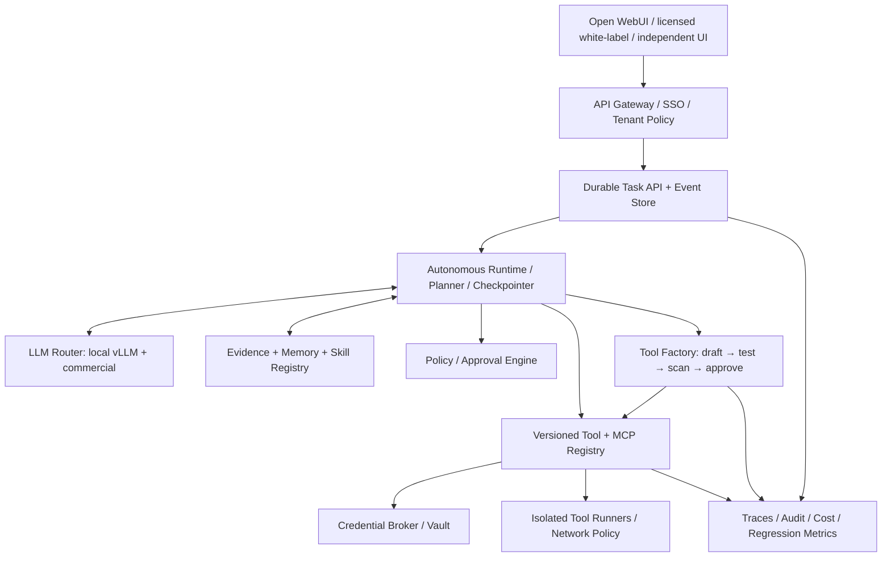

# Target system architecture

Current implementation: the durable runtime consumes scoped workspace/Git/test queues, Factory proposals/static triage/qualified execution, signed evidence and internal pure-JSON releases. ADR0016/schema0009 adds active versions and a separate durable invocation consumer; source executes only in a constrained container, never by host import. Actual paid-model generation/repair and cross-task reuse are demonstrated in INTERNAL_REGISTRY.md. General MCP/Skill activation, enterprise identity/broker/memory and production qualification remain incomplete. Earlier milestone descriptions below are historical snapshots.

The diagram is the **target topology**. Implemented components include API, PostgreSQL task/event/invocation queues, fenced async worker, checkpoints/SSE, trusted host sandbox supervisors and the supported Factory/registry tier. Identity remains a fixed development service principal; policy-aware model routing, vault broker and governed memory are future work. The user delegates development/internal-demo review to the trusted development agent, including its own proposals; runtime/model output does not receive approval authority.

## Six separate trust boundaries

1. **Browser ↔ Edge:** OIDC identity, tenant, scopes, rate limits and request ownership. Client `user` data is metadata, never principal proof.
2. **Edge ↔ Runtime:** Authenticated service calls. The runtime holds persistent task state, budget, policy and cancellation controls.
3. **Runtime ↔ LLM:** Models receive only classified, minimized task context and opaque tool descriptions. Route constraints prevent accidental movement to commercial endpoints.
4. **Runtime ↔ Sandbox:** Never direct `subprocess` or dynamically imported agent code in the API/orchestrator. Execution uses per-task isolated, ephemeral, non-root environments, CPU/memory/time limits, no host socket and deny-by-default egress.
5. **Sandbox ↔ External services:** All credentials remain server-side. Credential broker grants capability-bound short-lived handles; runners receive only strictly scoped ephemeral secrets via a dedicated channel.
6. **Candidate ↔ Published tool:** Candidate code is untrusted and cannot be invoked as a published capability until policy approval, test evidence, immutable artifact signing and registry activation.

## Module ownership

| Logical module | Owns | Must not own |
| --- | --- | --- |
| WebUI adapter | Conversation presentation, attachment UI, task event timeline | Tool execution, secrets, approval decision |
| Identity gateway | OIDC, tenant mapping, RBAC/ABAC, quotas | Business logic in prompts |
| Task runtime | Plan/act/observe/verify loops, steps, retry, checkpoint, cancellation | Long-lived secrets, untrusted code execution |
| Model broker | Endpoint catalog, capabilities, budgets, redaction, residency rules | Arbitrary tool code |
| Workspace + sandbox | Isolated repo checkout, patch, lint/test/build | Tenant admin access, unbounded network |
| Tool factory | Generates source/spec/tests and eval report | Model-originated approval authority or instant publishing |
| Tool/MCP registry | Versioned schemas, capabilities, lifecycle, dependency graph | Raw passwords or OAuth tokens |
| Credential broker | Vault connection, OAuth delegated grants, rotation, token lease | Prompts or model context |
| Evidence + memory | Artifacts, traces, distilled tested knowledge | Automatic promotion from raw chats |
| Audit/AOC | Full provenance and policy decisions, cost, coverage, regressions | Production execution permissions |

## Target flow: a coding task

1. User submits issue with workspace/repo grants and budget.
2. Gateway resolves identity and obtains a server-issued task-scoped capability.
3. Runtime stores the task and an append-only `TASK_CREATED` event before acknowledging.
4. Worker leases the task; builds an isolated workspace; obtains relevant versions of Skills and Tools.
5. Model plans. Runtime performs schema/policy/approval checks before every side-effecting tool invocation.
6. Workspace executes permitted commands only in isolated sandbox. Evidence captures exit code, sanitized logs, diff, hashes and test reports.
7. Runtime checks acceptance criteria; repairs if necessary within budget; otherwise moves to `WAITING_FOR_USER`, `FAILED`, or `COMPLETED`.
8. User sees streamed status/events and reviews diff before any external write (PR, merge, deploy).
9. After completion, memory candidates are extracted, deduplicated, reviewed/evaluated and only then promoted.

## Target flow: a newly invented MCP or Tool

1. Runtime discovers a capability gap; creates `TOOL_PROPOSAL` with justification and candidate manifest.
2. Generator writes source, typed tool schema, fixtures, unit/property/contract tests and declared dependencies.
3. Candidate executes in quarantined sandbox with fake credentials, restricted egress and resource ceilings.
4. Static checks, license/SBOM check, vulnerability scan, behavior eval, poison/injection tests, replay and rollback plan.
5. Policy engine calculates risk and requests proper reviewer approval. Candidate cannot approve itself.
6. Signed immutable artifact published as `tool_name@semver+digest`; activation is a separate event. Tenant policies opt into versions.
7. Observability and regression jobs track drift. Failure triggers disable/quarantine/rollback; old workflows remain version-pinned.

## Persistence and delivery decisions

- **Production:** PostgreSQL for tasks, runs, leases, events, approvals, pointers and lineage; object store for logs/artifacts; Redis or a broker only for ephemeral coordination. A queue message is not the system of record.
- **Local stage-0 spike:** SQLite via `sqlite3` for metadata and tests, *not* production concurrency or worker durability. M1 migrates to Postgres + migrations.
- **Workflow scheduler:** Implement lease + heartbeat + idempotent step dispatch before adding parallel branch/fan-out.
- **Streaming:** SSE event replay with monotonic event sequence IDs; reconnect from `Last-Event-ID`. Chat completion streaming protocol is an adapter concern.
- **Model contracts:** OpenAI-compatible APIs are a convenience edge. Maintain internal normalized `ModelCall`, `ToolCall`, `Observation`, `Usage`, and `PolicyDecision` types.
- **Tool transport:** MCP supported through supervised gateways. Do not run third-party MCP subprocesses in the API container.
- **Audit:** Each event includes tenant/task/step, actor, model/tool revision, input/output hashes, policy decision and trace ID, but never raw credentials.

## Phased production topology

P0: single API + fixtures, no real untrusted execution. P1: PostgreSQL, queue/worker and SSE. P2: separate sandbox service + repo/git tools. P3: tool factory + registry/promotion. P4: credential broker + OIDC authorization. P5: enterprise operations, isolation and release hardening.

## M1 implementation update — 2026-11-08

The backend now implements PostgreSQL runtime_* tables with Alembic, database queue claims/leases, separate asynchronous worker, bounded model/tool checkpoint loop, crash recovery, pause/cancel/resume, append-only event trigger and authorized SSE replay. See ADR 0001 and M1_RUNTIME.md. No Redis is required: queue state is stored transactionally with the task. SQLite remains only M0 metadata/unit-test support.

`caliburn-agent-durable` bridges OpenAI nonstreaming chat requests to durable tasks; the original model retains the M0 direct loop. API and worker run independently and share no long-lived external service secrets with model messages. Compose supplies a non-superuser runtime DB role and a separate migration role on an internal network. No untrusted source, repository commands or MCP subprocesses execute in either process.

The target topology above still describes future sandbox/factory/memory/broker/identity services. M1 is not that topology's completion. Approval waits fail closed; the update below adds narrow candidate review, while enterprise tenant principals and promotion remain later milestones. Actual Open WebUI smoke is verified below; product timeline and enterprise release acceptance remain pending.

## M2 workspace data operations — implemented subset

ADR 0002 adds an operator-registered immutable snapshot table and sandbox request/result queue. API/worker only submit typed requests; a separate operator host supervisor launches fixed one-shot containers for list/read/search/inert-patch. No agent Docker socket or host-command privilege was added, and no generated source/test execution path exists. Scope/TTL/revoke, task/controller leases, snapshot/tool/image hashes, output contracts and bounded recovery are checked before dispatch/result publication. M2_WORKSPACES.md documents the actual consumer, commands and migration 0002. Git checkout, independent candidate execution approval, actual tests/repair, benchmark and external writes remain incomplete.

## Lifecycle and UI transport update

New managed-v2 sandbox instances carry pre-start expiry and are reaped by the trusted supervisor on restart/periodic iterations; the full create handshake is cancellation-owned. This fixes an observed legacy late-created instance. It does not broaden agent/container authority. See ADR 0003 for actual limits and conditions.

Open WebUI browser smoke is now verified against a pinned unmodified upstream image and real PostgreSQL task. The durable chat facade emits OpenAI-compatible completion-level SSE; task SSE remains the worker-independent progress/replay protocol. Enterprise identity, product timeline and qualified candidate execution remain incomplete. Optional development profile and target-host ingress limitation are documented in OPEN_WEBUI_SMOKE.md.

## Independent candidate review subset

ADR 0004 adds a policy package with a real durable consumer: sandbox patch publication persists an immutable candidate; explicitly granted repo_request_review pauses the worker; an independent PostgreSQL reviewer role inspects and approves/rejects the exact bound artifacts through an operator CLI; a restarted worker rechecks and consumes the review without repeating the patch. Revocation/expiry invalidate approval. Ordinary API credentials cannot approve or resume a wait. Six additive policy tables preserve provenance and append-only decisions. This development DB control plane is not OIDC, cryptographic artifact signing or multi-tenant reviewer isolation. There is still no source/test executor or production registry activation. See CANDIDATE_REVIEW.md.

ADR 0005 supersedes the review-only execution limitation: a separate opt-in trusted-host supervisor consumes repo_test, checks an additional operator grant and exact independent review, then runs a fixed stdlib unittest plan against baseline and candidate in two fresh containers. The existing data supervisor filters out executable jobs. Both share fenced sandbox_jobs persistence and cleanup, while the API/worker still have no Docker/host execution access. Actual exit/hash/log evidence is consumed by the worker; completed evidence survives a worker-checkpoint interruption. No schema migration is needed. All defaults remain data-only; production qualification/activation, enterprise identity and iterative repair/checkout remain incomplete.

ADR 0006 adds nullable immutable candidate ancestry (migration 0004) and a running parent-based repair consumer. repo_patch can revise the full same-task parent bundle; server validation checks scope/hash/base and bounded ancestry. Binding v3 names parent and patch-source hashes. Actual fixture inference observes failing container tests, creates a child and waits for a new independent review before retest. Cumulative budgets and rejection prevent further execution. This supersedes the previous iterative-repair mechanism limitation, while actual Git checkout, real-model benchmark and enterprise release gates remain open.

ADR 0007 adds a concrete operator Git checkout/handoff consumer of durable tasks/candidates. A fresh repository reconstructs only granted snapshot files, performs a real derived-baseline checkout and stages exact candidate bytes for actual Git diff. Original source commit remains separate provenance; original history is not cloned. The separate CLI checks read grant/scope/hash/ancestry and publication-time validity. API/worker/agent gain no host Git process or filesystem access. No schema/tool digest/dependency change occurs. Actual operator checkout is implemented; agent-contained original-history workspace and real-model/repository benchmark remain open.

ADR0008 prepares a fixed-image repo_git_status consumer through the durable sandbox queue: explicit operator git_inspect permission/image pin, server-side candidate scope/hash checks, separate Git supervisor and bounded fixed data driver. Shared stdlib Git logic preserves operator checkout behavior. Actual DB/worker/host-Git fixture tests run; the Docker Git image is not built and container qualification remains pending explicit license-risk approval. No live grant or new agent host authority is enabled. The proposed development image contains Debian Git and requires its own recorded dependency/notice review; it is not a customer release. See GIT_DATA_APPROVAL.md for exact proposed build and current evidence limits.

ADR0009 implements the previously missing independent task timeline UI. caliburn.web serves inert packaged self-hosted assets; task data/actions remain on authenticated APIs. A new bounded read-only history projection supplies run/step metadata and hashes without raw step input/output or leases. The console consumes actual Task/Run/Step/Event/review state, budgets/results and server pause/cancel/resume transitions; automatic bearer-authenticated fetch SSE reconnects with contiguous Last-Event-ID. Actual PostgreSQL/browser/separate-worker and injection/control/reconnect checks are verified. There is no UI approval bypass, new identity permission, Open WebUI source change or schema migration. OIDC/customer identity and embedded upstream navigation remain open; see TASK_CONSOLE.md.

## Independent Factory triage increment

ADR0011/schema0006 adds separate static-check queue, narrow independent verifier DB role/process, append-only hash-bound reports and actual runtime/API consumers. No candidate code/test/MCP/skill executes. Runtime cannot publish reports; reviewer authority for repository tests does not confer verifier authority. Reports remain incomplete evidence and cannot activate source. See FACTORY_STATIC_CHECKS.md.

## Factory execution-only increment

ADR0012 adds default-off execution review and actual fixed-image stdlib test consumption of Factory bundles. Separate reviewer and host executor roles have no Task mutation authority; runtime wakes approved waits. Six additive tables bind source/report/plan/image/implementation/limits and immutable results. Step/job replay reuses completed evidence after an actual worker process crash, without another container dispatch. Existing data/repository/Git supervisors cannot consume this queue. Migration0007 also fixes temporary-table shadowing of authority lookups across13 stored trigger functions without SECURITY DEFINER. Source stays QUARANTINED and no signing/active registry exists. See FACTORY_EXECUTION.md.

## Independent signed evidence subset (0008)

A distinct owner-configured signer role/process consumes completed actual Factory execution plus its runtime checkpoint, signs full scoped source/test/manifest/declaration/static/review/execution evidence with Ed25519, and appends immutable EVIDENCE_ONLY receipts. API and capability lookup verify signatures against separate public trust mappings and live revocation before exposing read-only evidence to unrelated tasks. Private keys never enter runtime/model/sandbox. No production approval/active registry/invocation authority is created; full qualification remains open. See SIGNED_EVIDENCE.md/ADR0013. The separately authorized live gpt-6-luna arithmetic smoke verifies real multi-step model/tool persistence, not Factory or repository-coding quality; see LIVE_MODEL_VALIDATION.md.

## Host-owned Factory comparison (execution bindingv2)

ADR0014 places the behavior comparator in the existing trusted host executor, outside every subject container/PID namespace. Existing owner-controlled plan JSON binds host-only expected vectors and a separate child test-plan subset. Every invocation uses a fresh inspected/approved container with only immutable source/entrypoint/input; expected values and pass authority never enter it. The durable consumer and signer reject incomplete/mismatched host proof. Actual child exit/output/hash remain separate from aggregate full-plan evidence. No schema migration, new role/permission or host-source execution. Finite observations are not full adversarial/security/release qualification; see HOST_ORACLE.md.

## Repeat/order/replay and registry direction

ADR0015 extends the host-owned comparator to four fresh sessions and two calls per vector, preserving separate owner/reviewer/executor boundaries and bounded budgets. Bindingv3/host-oracle-v2 require complete session/observation proof for new durable PASSED/signatures. Normalized all-manifest-string triage fixes metadata/source namespace shadowing and selected obfuscated override patterns. No schema migration or activation is added by this increment. The next product slice is independent supported-tier release, immutable active version selection, actual scoped invocation/reuse and rollback, not indefinite additions to evidence-only gates. PROPERTY_QUALIFICATION.md records exact scope.
